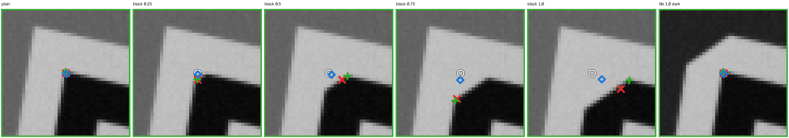
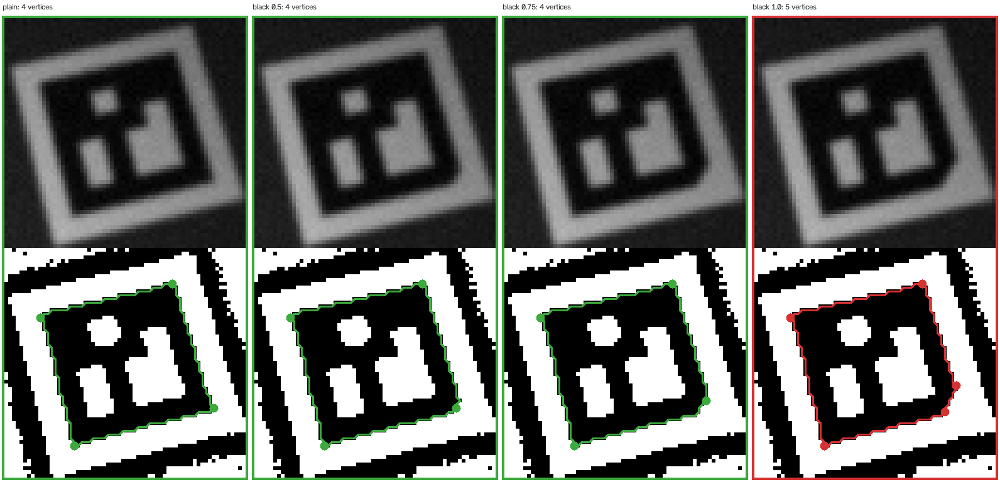
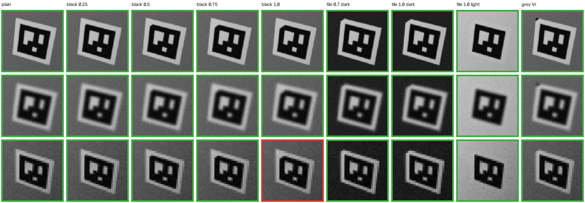
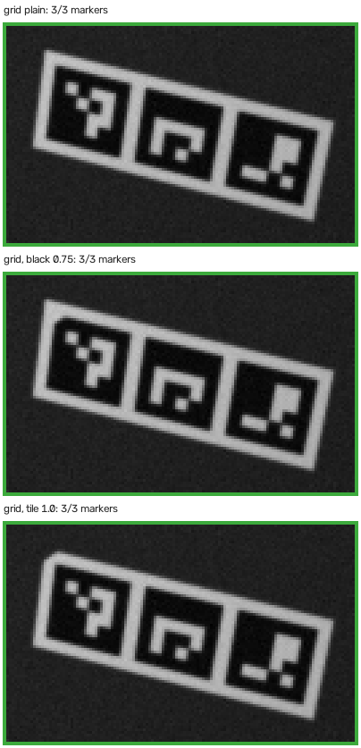
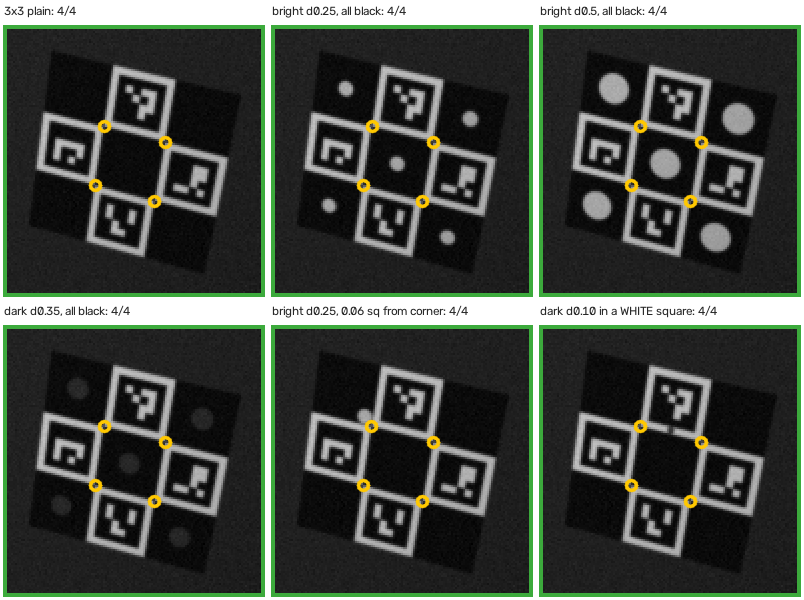
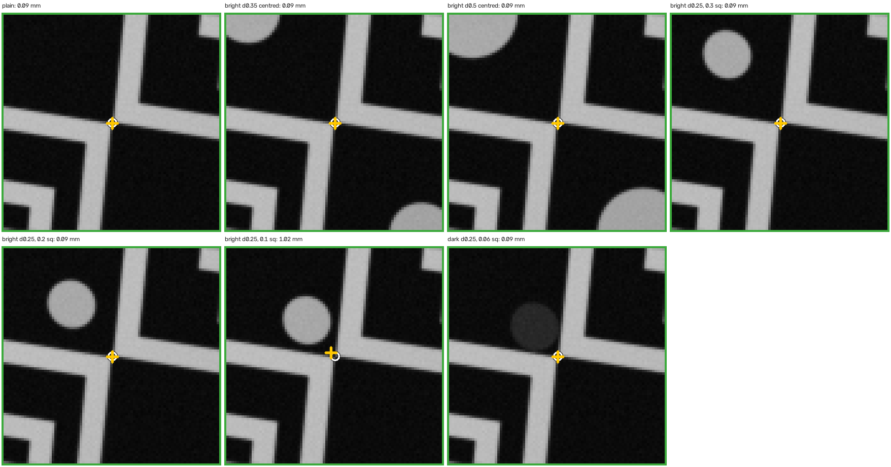

# A chamfered corner as the orientation cue on 3D-printed tags (and screws in ChArUco boards)

**Don't cut the black square. Cut the white tile.** Cutting the black marker's corner 0 is the one place a chamfer hurts. At legs of 0.5 module it loses 2.5 pts of detection, and at 1.0 module it loses 32 pts. Even at 0.25 module, where detection is unchanged, it moves corner 0 by 0.07 module on average (0.3 mm on a 30 mm marker) and makes the single-marker pose worse. Cutting the white tile's corner instead costs nothing that matters: within ±0.6 pts on a dark, a mid-grey or a light part, and corner 0 does not move. **ChArUco** is different, because its top-left square is black and its outer corner is not a ChArUco corner. Cutting it changed nothing, not in a single trial. **Screws** in the black squares are fine, centred and up to about a third of the square. The corner count never suffers. What suffers is accuracy, when a bright head comes within about 0.3 square of an inner corner. Very occasionally a head also makes a black square read as a stray marker, id 17.

Study, 2026-10-08, branch `claude/aruco-fusion-plugin-0e9bcb`, for Zach. Experiment: `tools/study_aruco_chamfer.py`, which imports the marks study `tools/study_aruco_marks.py` and reuses its whole pipeline. That is 298,000 simulated photos on OpenCV 5.0.0 (single markers and grids each through three detector settings), with the single-marker and grid parts repeated on 4.10.0. Every number below is in `reports/media/aruco/chamfer/results.json`. The earlier study is [proposal_aruco_marks.md](proposal_aruco_marks.md).

## 1. The questions

> "add a chamfer on the black marker" ... "can you please double check that the chamfer black edge doesn't affect detection performance; I forget what the report found"

> "can I put screws in the different checker boards? I think I should be ok right? it's about their intersection that is detected?"

A 3D printer has no grey, so the sheet's grey corner triangle can't be printed. The idea is to mark corner 0 by shape instead.

## 2. What the earlier report actually measured

`chamfer_tl` (+0.3 pts, lost 21 / gained 30 of 3000) did **not** touch the black square. It cut the *sticker's* outline: the quiet zone's top-left corner, at 45° with 0.7-module legs, on a 1-module quiet zone. What showed through the cut was the part the sticker sat on, which was white paper, mid grey or dark grey, a third of the trials each. The cut line stayed 0.92 module (diagonally) clear of the black corner. In 3D-print terms, that was a **white-tile chamfer**. A cut into the black square, the outline OpenCV actually traces, had never been measured. This study measures it.

The rerun reproduces the old numbers exactly. On the first 3000 trials (the old stress mix, photo for photo) the plain marker is detected in 79.97 %, `tri_tl` gives +0.2 (27 / 34), `tri_tl_near` gives −13.4 (445 / 43), and the 0.7 tile cut gives +0.3 (21 / 30).

## 3. How it was measured

The pipeline is the marks study's, unchanged: a vector PDF, rasterised by pdfium, through the printer model (ink spread 0–0.12 module, contone or halftone) and the pinhole camera (2.8–10 px/module, tilt to 65°, blur, noise, JPEG, uneven light) into `cv2.aruco`. The conditions and seeds are the study's own. Every design sees the same photos, so differences are paired: lost / gained trials, a McNemar test and a 95 % interval. What this study adds:

- **Candidates**, all on DICT_4X4_50 with module units and the origin at the black square's top-left.
  - `bch_<leg>`: the black square's corner 0 cut at 45°, legs 0.25 / 0.5 / 0.75 / 1.0. The cut shows **white**, as the white tile fills it in a print.
  - `tch_<leg>`: the white tile's corner cut at 45°, legs 0.5 / 0.7 / 1.0, on a 1-module quiet zone. The cut shows the **part**. These run on the usual mix of part colours, and again with every trial on a dark (0.15), a mid (0.45) and a light (0.85) part. `tch_070` is `chamfer_tl`.
  - `tri_tl` and `tri_tl_near` from the old study, as references.
- **Three detectors:** OpenCV's default (no refinement), `CORNER_REFINE_SUBPIX` and `CORNER_REFINE_CONTOUR`. Refinement only moves corners, so all three detect exactly the same photos.
- **Corner 0's error in the marker plane**, in modules, with sign. On a 30 mm 4x4 marker, 1 module = 5 mm.
- **Pose against the exact pose the camera was given.** Single markers use `solvePnP(SOLVEPNP_IPPE_SQUARE)` at 200 mm. Boards use `solvePnP` (`ITERATIVE`, which is what `estimatePoseBoard` and `estimatePoseCharucoBoard` called) on all detected corners.
- **Boards.** A 3 × 1 GridBoard (gap 1.2 modules, quiet zone 1, at 560 mm) with only the top-left marker's corner 0 cut. ChArUco runs on the study's 5 × 4 board (quiet 1) and on a 3 × 3 board with no quiet zone, which is what `aruco_autosize` makes (marker 0.75 of the square). The 3 × 3 board stands for Zach's 37 mm squares, where 1 module = 4.6 mm.
- **Trials:** 6000 per single-marker design, 3000 per grid and 3 × 3 design, and 2000 on the 5 × 4 board.

## 4. Single marker

### 4.1 Detection

The plain marker is detected in 80.2 % of the 6000 photos. In the "worst print condition" column, c means contone grey and h means halftone. The digit is the ink spread: 0, 0.04, 0.08 or 0.12 module.

| Candidate | Detection vs plain, pts [95 % CI] | Lost / gained | Worst print condition |
|---|---|---|---|
| `bch_025` black cut, legs 0.25 | +0.2 [−0.4, +0.8] | 152 / 166 | c1 −1.1 (9 / 1) |
| `bch_050` black cut, legs 0.5 | **−2.5** [−3.3, −1.6] | 397 / 249 | h2 −4.4 (56 / 23) |
| `bch_075` black cut, legs 0.75 | **−12.7** [−13.8, −11.6] | 962 / 201 | h2 −20.0 (170 / 21) |
| `bch_100` black cut, legs 1.0 | **−31.6** [−32.9, −30.3] | 2061 / 166 | c2 −37.8 (286 / 16) |
| `tch_050` tile cut, legs 0.5 | +0.1 [−0.2, +0.4] | 51 / 56 | h0 −0.5 (7 / 3) |
| `tch_070` tile cut, legs 0.7 (= `chamfer_tl`) | +0.1 [−0.3, +0.4] | 54 / 57 | h2 −0.5 (6 / 2) |
| `tch_100` tile cut, legs 1.0 | −0.2 [−0.6, +0.2] | 79 / 68 | h3 −0.9 (24 / 17) |
| `tri_tl` grey triangle (today's default) | −0.1 [−0.5, +0.2] | 66 / 58 | c3 −0.8 (19 / 13) |
| `tri_tl_near` triangle into corner 0 (anti-example) | −13.9 [−14.9, −12.9] | 924 / 91 | h3 −30.3 (260 / 18) |

On OpenCV 5.0.0 there were no wrong ids and no flipped corner orders in any design, any detector or any trial. On 4.10.0 the chamfers had none either; the only wrong id was one photo of `tri_tl_near`.

Even the free 0.25 black cut changes the outcome of 318 photos (152 lost, 166 gained), where the tile cuts change 107–147. Those changes simply cancel out.

### 4.2 Corner 0 and pose

These numbers come from the same stress mix, on the photos where both the plain marker and the variant were detected. The corner-0 shift is the mean increase in corner 0's error, in modules, with mm on a 30 mm marker in brackets. Its confidence interval is ±0.008 module or tighter for every row. The pose columns give the paired mean change in translation (mm at 200 mm) and rotation (°) for default / SUBPIX / CONTOUR.

| Candidate | Corner-0 shift, default | SUBPIX | CONTOUR | Δ translation, mm | Δ rotation, ° |
|---|---|---|---|---|---|
| `bch_025` | +0.067 (0.34) | +0.058 (0.29) | +0.010 (0.05) | +0.43 / +0.17 / +0.02 | +0.36 / +0.81 / −0.01 |
| `bch_050` | +0.221 (1.11) | +0.258 (1.29) | +0.045 (0.23) | +1.44 / +1.19 / +0.15 | +2.2 / +3.9 / +0.6 |
| `bch_075` | +0.389 (1.95) | +0.435 (2.18) | +0.107 (0.54) | +2.73 / +2.37 / +0.39 | +4.8 / +6.8 / +1.9 |
| `bch_100` | +0.538 (2.69) | +0.576 (2.88) | +0.181 (0.91) | +4.16 / +3.54 / +0.77 | +7.4 / +9.1 / +3.5 |
| `tch_050` | +0.003 (0.02) | +0.002 | +0.002 | +0.06 / +0.04 / +0.05 | −0.04 / −0.03 / +0.00 |
| `tch_070` | +0.005 (0.03) | +0.004 | +0.003 | +0.05 / +0.04 / +0.04 | −0.01 / −0.04 / −0.01 |
| `tch_100` | +0.008 (0.04) | +0.009 (0.05) | +0.006 (0.03) | +0.10 / +0.07 / +0.04 | −0.10 / −0.09 / −0.01 |
| `tri_tl` | +0.004 | +0.004 | +0.002 | +0.04 / +0.04 / +0.02 | +0.02 / +0.01 / −0.01 |
| `tri_tl_near` | +0.099 (0.50) | +0.120 (0.60) | +0.026 (0.13) | +1.18 / +1.36 / +0.38 | +3.7 / +4.0 / +0.8 |

For scale, the plain marker in this hard mix has a corner-0 error of 0.19 / 0.16 / 0.14 module (default / SUBPIX / CONTOUR), mostly from ink spread, which all designs share. Its median pose error is 3.7 / 3.0 / 3.8 mm and 2.7 / 2.3 / 1.2°.

On clean photos (no noise or spread, 200 trials per point) the bias is systematic, not noise.

| Corner-0 error at 12 px/module, flat, module | Default | SUBPIX | CONTOUR | Detected |
|---|---|---|---|---|
| plain (`tch_*` and `tri_tl` are identical) | 0.052 | 0.015 | 0.059 | 100 % |
| `bch_025` | 0.211 | 0.133 | 0.071 | 100 % |
| `bch_050` | 0.416 | 0.481 | 0.117 | 100 % |
| `bch_075` | 0.645 | 0.704 | 0.208 | 94.5 % |
| `bch_100` | 0.777 | 0.803 | 0.270 | **50.0 %** |

At 8 px/module and 35° of tilt, the median rotation error goes from 1.19 / 0.33 / 0.39° (plain) to 1.92 / 1.45 / 0.47° with the 0.25 cut, and to 3.80 / 4.77 / 0.86° with the 0.5 cut. CONTOUR refinement mostly undoes the cut, but its own baseline is worse than SUBPIX's on a plain marker (0.059 against 0.015 module above). So switching refinement to live with a cut trades away more accuracy than it saves.



*In the picture above, the white ring is the true corner 0. The red × is OpenCV's default corner, the green + is SUBPIX and the blue ◇ is CONTOUR. With a black cut, the default and SUBPIX corners slide along the cut by most of its leg.*

### 4.3 Why the black cut fails

OpenCV first traces the black square's outer outline and simplifies it to a polygon with a tolerance of 3 % of its length, about 0.72 module on a 4x4 marker. A small cut is absorbed by that tolerance, but corner 0 then lands on one end of the cut instead of on the true corner. Corner refinement does not repair this, because SUBPIX settles on the cut's real 135° vertex. The shifted corner skews the grid the bits are read from, so near corner 0 the cells are sampled off-centre.

From 0.75 module the cut often exceeds the tolerance, and the outline becomes a pentagon that is never decoded. Most of the extra misses, though, are 4-sided outlines whose bits read wrong. The default detector's misses, out of 6000:

| | Detected | 4-sided outline, rejected when its bits were read | No 4-sided outline |
|---|---|---|---|
| plain | 4810 | 979 | 211 |
| `bch_025` | 4824 | 964 | 212 |
| `bch_050` | 4662 | 1088 | 250 |
| `bch_075` | 4049 | 1530 | 421 |
| `bch_100` | 2915 | 2135 | 950 |



*One photo at 6.4 px/module, thresholded as the detector does. In this photo the camera's roll puts corner 0 at the bottom right. The 1.0 cut leaves five vertices, so the marker is never decoded.*

### 4.4 The tile cut on a dark, mid and light part

These 6000-trial runs use the same photos, with every one on the given part. The corner-0 error is the default detector's, before and after the cut.

| Part | Plain detected | `tch_050` | `tch_070` | `tch_100` | Worst cell (`tch_100`) | Corner-0 error, `tch_100` |
|---|---|---|---|---|---|---|
| dark (0.15), like Zach's plate | 81.4 % | +0.1 [−0.2, +0.5] | +0.1 [−0.3, +0.5] | −0.3 [−0.7, +0.2] | h3 −1.2 (33 / 23) | 0.224 → 0.241 |
| mid grey (0.45) | 81.8 % | −0.3 [−0.7, +0.1] | −0.5 [−0.8, −0.1] | −0.6 [−1.0, −0.1] | h3 −1.5 (36 / 24) | 0.198 → 0.207 |
| light (0.85) | 77.6 % | +0.2 [−0.1, +0.4] | +0.1 [−0.2, +0.4] | +0.2 [−0.1, +0.5] | c0 −0.3 (4 / 2) | 0.156 → 0.156 |

Everything is within a point. A mid-grey part shows a just-significant half point at legs 0.7–1.0, the part colour closest to the detector's threshold. On a dark part, which is what makes the cut visible, the median pose changes by 0.08 mm.



*Green means detected and red means missed, with the default detector. The first two rows are fixed conditions. The third row was picked by a deterministic search for a hard photo whose outcome matches the measured pattern, because single photos near the detection limit flip either way.*

## 5. GridBoard 3 × 1

Only the top-left marker is cut. The board needs any one marker for a pose, so the board as a whole barely notices. The cut marker does, and so does the pose whenever that marker is used. There were 3000 trials. The Δ pose columns are paired, on photos where marker 0 was found in both the plain board and the variant, for default / CONTOUR. The plain board's median error is 5.4 mm at 560 mm.

| Candidate | Board found (≥ 1 marker) | Marker 0 found (lost / gained) | All 3 found | Δ translation, mm | Δ rotation, ° |
|---|---|---|---|---|---|
| `g_tri` grey triangle | −0.0 | −0.3 (28 / 20) | −0.1 | +0.05 / +0.04 | −0.01 / +0.06 |
| `g_bch_050` | −0.3 [−0.7, +0.2] | **−2.4** (177 / 106) | −2.0 | +0.96 / +0.08 | +0.74 / +0.21 |
| `g_bch_075` | −0.7 [−1.2, −0.2] | **−11.3** (437 / 98) | −8.3 | +1.96 / +0.27 | +1.71 / +0.57 |
| `g_bch_100` | −1.4 [−1.9, −0.9] | **−28.3** (928 / 80) | −22.4 | +2.84 / +0.41 | +2.10 / +0.90 |
| `g_tch_100` tile cut, legs 1.0 | −0.1 [−0.4, +0.2] | −0.1 (32 / 28) | −0.0 | +0.05 / +0.02 | +0.03 / +0.04 |



## 6. ChArUco: the top-left square is black

`aruco_board._charuco_black(0, 0, rows, legacy)` is true unless `legacy` is set *and* the row count is even. `legacy` defaults to `False` in the feature's settings (`aruco_feature.py`), in `aruco_tags.py` and in `markers.TagSpec`, so every board the plugin makes by default has a **black** top-left square. Its outer corner is a board corner, not a ChArUco corner: the detector only refines inner chessboard corners. That square's chamfer was measured anyway.

| Board | Candidate | Corners found, Δ mean [CI] | Fewer / more | Corner error and pose |
|---|---|---|---|---|
| 5 × 4, quiet 1 (2000 trials, 7.80 of 12) | black square cut, legs 1 and 2 modules (white shows) | +0.000 | **0 / 0** | identical in every trial |
| | tile cut, legs 1 (part shows) | +0.000 [−0.007, +0.007] | 11 / 15 | unchanged |
| 3 × 3, no quiet zone (3000 trials, 2.72 of 4) | black square cut, legs 1 and 2 modules (white shows) | +0.000 | **0 / 0** | identical in every trial |
| | tile cut, legs 2 (part shows) | −0.002 [−0.007, +0.003] | 12 / 7 | unchanged |

The cut is several modules from every marker and from the nearest inner corner, which is all the detector looks at, so the detections are bit-for-bit the same. On a no-quiet-zone board sitting on a dark part, a tile cut shows dark where there was black, which is invisible. Cutting only the black square, so the white tile shows, is visible on any part.

If a board were ever made with `legacy=True` and an even row count, its top-left square would be white, holding a marker one module in. Cut that square's outer corner exactly as the single tile cut in section 4 (legs ≤ 1 module).

## 7. Screws in a ChArUco board

> "it's about their intersection that is detected?"

Yes. `CharucoDetector` finds the markers in the white squares by their own black borders, predicts each inner corner from them, and refines it with `cornerSubPix` in a small window around that intersection. Black squares play no part in finding markers. A screw head therefore never costs a corner. What it can do is pull a corner off, when it sits inside that window.

The board is 3 × 3 with no quiet zone and 37 mm squares, with 3000 trials per design. Heads are flat discs, either dark (reflectance about 0.22, a black screw or a hole) or bright (about 0.80, bare metal). The plain board finds 2.72 of its 4 corners on average. Its pose needs all 4 and is available in 59.3 % of photos, with median errors of about 1.25 mm and 0.57°.

**Centred in the black squares.** On a 3 × 3 board the four corner squares each touch one inner corner, and the centre square touches all four. Each cell below is the change in mean corners found (trials with fewer / more).

| Head diameter (of square; on 37 mm) | Dark, 4 corner squares | Dark, all 5 black | Bright, 4 corner squares | Bright, all 5 black |
|---|---|---|---|---|
| 0.15 (5.6 mm) | +0.000 (1 / 1) | +0.000 (1 / 2) | +0.000 (4 / 4) | +0.001 (4 / 5) |
| 0.25 (9.3 mm) | +0.000 (1 / 2) | +0.000 (2 / 2) | +0.002 (11 / 14) | +0.001 (14 / 14) |
| 0.35 (13 mm) | −0.000 (4 / 3) | −0.002 (6 / 2) | +0.003 (13 / 18) | +0.001 (21 / 21) |
| 0.5 (18.5 mm) | +0.002 (12 / 14) | +0.002 (14 / 17) | +0.001 (40 / 45) | −0.006 (62 / 51) |

Up to 0.35 the corner error and the pose do not move: the corner error changes by about 0.001 mm, the translation by 0.003 mm or less, and the rotation by about 0.03°, none of it significant. At 0.5, whose edge is 0.46 square from the inner corners, bright heads leave a first trace in the worst poses: +0.22° [+0.01, +0.43] in the four corner squares and +0.12° [−0.05, +0.29] in all five. The median is unchanged at 0.57°.

**Off-centre, pushed along the diagonal towards one inner corner.** Here the gap is from the head's edge to that corner. The corner's error is in mm, against 0.19 mm for the plain board.

| Head | Gap to the inner corner (square; mm) | Δ corners found | That corner's error, mm | Δ translation, mm | Δ rotation, ° (mean; median) |
|---|---|---|---|---|---|
| bright, d 0.25 | 0.30 (11 mm) | −0.003 [−0.009, +0.003] | 0.21 | +0.01 | +0.95 [+0.45, +1.44]; 0.58 → 0.61 |
| | 0.20 (7.4 mm) | −0.011 [−0.019, −0.002] | 0.29 | +0.17 | +3.1; 0.57 → 0.78 |
| | 0.15 | −0.011 | 0.51 | +1.49 | +5.8 |
| | 0.10 (3.7 mm) | −0.017 [−0.030, −0.004] | 0.77 | +3.54 | +6.4; 0.56 → 2.14 |
| | 0.06 | −0.003 | 0.86 | +3.36 | +6.9 |
| bright, d 0.15 | 0.10 / 0.06 / 0.035 | −0.010 / −0.012 / −0.004 | 0.54 / 0.92 / **1.76** | +2.0 / +3.4 / **+9.5** | +4.4 / +12.1 / **+18.2** (43 corners > 1 module off) |
| bright, d 0.5 | 0.20 / 0.11 | −0.016 / −0.015 | 0.35 / 0.98 | +0.38 / +5.47 | +5.5 / +9.5 |
| dark, d 0.25 | 0.10 / 0.06 | −0.006 / −0.005 | 0.22 / 0.25 | −0.00 / +0.01 | +0.09 / +0.21 (n.s.) |

**Phantom markers.** Now and then, a centred head of 0.15–0.35 square, dark or bright, made an outer black corner square read as a marker that is not on the board. It was always DICT_4X4_50 **id 17**, whose code is a 2 × 2 white block near the middle of an otherwise black field.

- It happened in 1–5 of 3000 photos per design, at most 0.17 %. It never happened with a 0.5 head, and never on the plain 3 × 3 board. Every case checked was on one of the four outer corner squares: the centre square meets the others at its corners, so its outline does not close into a clean square.
- For scale, the study's plain 5 × 4 board produces phantoms too: ids 17 and 37, once each in 2000 photos.
- The board ignores ids it does not own, so its corners and pose are unaffected, as the tables show. But anything else reading markers from the same image sees an id 17 there.
- So don't give id 17 to another tag on the same robot, and filter detections to the ids you expect. A board whose own ids include 17 would see two of them; that was not tested.

**In a white square.** A dark head 0.1 square across (3.7 mm), centred in the 1-module margin under a marker, costs **−0.52 corners** [−0.55, −0.49] per photo (868 photos with fewer corners, 19 with more). The chance of getting all 4 corners drops by 23 pts, and a pose becomes available in 36 % of photos against 59 %. It breaks the marker's outline, exactly like ink in the white ring.





*In the zoom above, the white ring is the true corner and the yellow + is the reported one. A bright head 0.1 square from the corner drags it by 1 mm. The same head 0.2 square away, and a dark head even at 0.06, leave it alone.*

**The rule:**

- **Safe:** centre the head in a black square, at most 0.35 of the square across (13 mm on a 37 mm square). Its edge then stays at least 0.5 square (18.5 mm) from every inner corner the square touches. Dark or bright, in the corner squares or in every black square, nothing is measurable.
- **Still fine:** up to half the square across, centred, which leaves 0.45 square of clearance. The corners are unchanged, with a first trace in the worst poses.
- **Avoid:** a bright head closer than 0.3 square (11 mm) to an inner corner. The corner is still found, but it is pulled 0.1 mm at 0.2 square and 0.6 mm at 0.1 square, and the board's rotation is off by degrees. A matte black head is nearly harmless anywhere in the black, but a glossy one that catches the light behaves like a bright one.
- **Rarely** (at most 0.2 % of photos), a centred head makes a corner square read as a phantom **id 17**. The board doesn't care, but keep id 17 off any other tag on that robot.
- Towards the board's *outer* edges and corners there is no limit beyond staying inside the black. The outer corner is not a ChArUco corner: a white two-module cut there changed zero trials (section 6).
- **Never** put a screw in a white square.

## 8. Recommendation: the default checkbox geometry

| Tag type | The 3D orientation cue | Geometry | Why |
|---|---|---|---|
| **Single marker** | Cut the **white tile's** top-left corner (OpenCV corner 0). The part shows through. Leave the black square whole. | 45°, legs **0.7 module** by default (3.5 mm on a 30 mm 4x4 marker), at most 1.0. On other quiet zones q, keep the 0.71-module diagonal clearance that the largest cut measured leaves at q = 1: legs ≤ 2q − 1 module. | +0.1 [−0.3, +0.4] pts, corner 0 moved by 0.005 module, pose unchanged, on dark, mid and light parts |
| **GridBoard** | The same, at the board tile's top-left corner: the board's frame origin and the top-left marker's corner 0 | the same | measured at legs 1.0: marker 0 −0.1 pts, board pose +0.05 mm |
| **ChArUco** | Cut the top-left **black square's** outer corner, with the white tile filling it | 45°, legs up to **2 modules** (0.25 square, 9 mm on a 37 mm square) | zero trials changed. It shows white on any part colour; a whole-tile cut would vanish on a dark part. |

- **Is a black-corner chamfer safe? No, not on a single marker or a grid marker.** 0.25 module is the only size that keeps detection, and it is 1.25 mm on a 30 mm marker, about three nozzle widths. Even then it costs pose accuracy: +0.4 mm and +0.4° by default, and +0.8° with SUBPIX, at 200 mm. From 0.5 module up it costs detection as well.
- **Is the white-tile chamfer the better 3D cue? Yes.** It is free at every leg tried, and it is the same corner and the same `key_corner` the marks study already proposed for loose tiles (which also stops a tile going into its pocket rotated).
- **A light part, where a white tile on white plastic gives no cut you can see:** print the old corner triangle in black filament. The marks study measured `tri_tl_black` at +0.2 [−0.3, +0.8], with no corner shift. Keep its 0.6-module legs, about one module clear of corner 0.

## 9. Caveats

- **This is a simulation.** It uses the marks study's print and camera model. A 3D print has no halftone, and its "ink spread" is extrusion and colour-change error. The same printer conditions were kept so that every number stays comparable with the earlier study.
- **OpenCV versions.** All the numbers above are cv2 5.0.0. The single-marker mix and the grid were repeated on cv2 4.10.0 (Zach's `smart_sign` venv, in `results_cv410.json`). There, the plain marker is detected in 81.6 % of photos instead of 80.2 %. Every design's change agrees within 0.3 pts: −2.3 / −12.4 / −31.4 for the 0.5 / 0.75 / 1.0 black cuts, and +0.1 / +0.1 / −0.2 for the tile cuts. Every corner shift agrees within 0.005 module, and marker 0 on the grid agrees within 0.3 pts (−2.4 / −11.4 / −28.1, and −0.3 for the tile cut).
  - On 4.10, `CORNER_REFINE_CONTOUR` raised an assertion (`_interpolate2Dline: nContours.size() >= 2`) on one grid photo out of 3000. It was the same photo for every design, the plain board included, so it is a 4.10 bug and not the cut. 5.0.0 never raised. The study counts such photos as missed, so a pipeline using CONTOUR on 4.10 should guard the call.
  - 4.10 also reported 2–5 spurious ids per grid design (summed over the three detectors). They came as often with the triangle and the tile cut as with the black cuts.
- **Pose errors are heavy-tailed.** Near-frontal views make the two IPPE poses compete, and the 3 × 3 board solves from only 4 corners. The tables give paired means, with medians where the tail drives the mean.
- **The screw heads are idealised:** flat uniform discs, with no glint, no shadow ring and no socket. The ChArUco runs use contone print only, as the marks study's ChArUco runs did.
- **No real photos yet.** The next step is cheap: print one single tag with a 0.7-module tile cut and the 3 × 3 board with centred screws, and photograph them in the acceptance flow.

## 10. Reproduce

```
PYTHONPATH=<cv2 + numpy + pypdfium2> python tools/study_aruco_chamfer.py   # ~12 min, 11 workers
python tools/study_aruco_chamfer.py --quick                                # smoke run, 1/10 of the trials
python tools/study_aruco_chamfer.py --media-only                           # redraw the images
python tools/study_aruco_chamfer.py --only single --only grid --tag cv410  # another OpenCV -> results_cv410.json
```

Images are in `reports/media/aruco/chamfer/`: `camera_single.png`, `corner0_zoom.png`, `outline_black_chamfer.png`, `camera_grid.png`, `camera_charuco_screws.png`, `screw_corner_zoom.png`, and every design as drawn and as printed in `variants/`.
