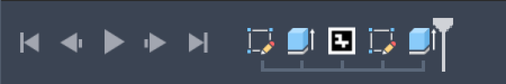

# Research: the ArUco tag as ONE feature in Fusion's timeline

Date: 2026-10-07. Fusion 2705.1.15 (installed 2026-09-08). Asked by Zach, pointing at the timeline strip: can the ArUco tag be its own feature, one icon you double-click to edit?

**Answer: yes. It is proven in this build.** A tag can be one timeline node with our ArUco icon. Fusion's Edit Feature on that node runs our edit command. A compute hook rebuilds the cells when the tag's parameters change and when upstream geometry moves or resizes the face. A hole made after the tag stayed healthy through all of it. Undo is one clean step, and delete removes the whole tag. It works in Hybrid, Part and Assembly designs.

It rests on the **Custom Features API, which is still preview**. It also needs two set-up conditions that nothing documents; without them the API fails with cryptic errors (see "The two traps").

**Recommendation: adopt opt-in.** Add a "Live tag (preview API)" path to `add_tag`, and fall back to today's timeline group if anything fails. Make it the default once Zach has passed the three manual checks at the end.



*Fusion's own timeline during a probe run, captured with PrintWindow: `tile outline` sketch, `Extrude1`, **the ArUco tag** (base feature and combine folded inside), then the hole's sketch and extrude.*

## How it was tested

- **The probe:** `ArucoMarkers/aruco_cf_probe.py`, driven through the dev bridge (`cf_*` actions, appended to `aruco_actions.ACTIONS`).
- **Safety:**
  - Every run checks `ui.activeCommand == "SelectCommand"` first.
  - It creates its own new document and never saves.
  - A `finally` closes that document and re-activates the one that was active before.
  - Runs took 2–11 s (most of the time goes to viewport captures).
  - Zach's documents were never touched. A final check found no probe feature in any open document.
- **The host add-in:** registration goes through a throwaway add-in that `host(op="start")` writes to `~/CADExporter/_aruco_cf_host/ArucoCfHost`, links and runs. `host(op="stop")` stops and unlinks it, and its `stop()` removes every handler and command definition. The Scripts and Add-Ins list ended as it began.
- **Images:** `reports/media/aruco/timeline_feature/` (`00_*` is Fusion's window; `01`–`05` are viewport captures).

Reproduce:

```
python tools/aruco_bridge.py cf_host --arg op=start                  # registers the definition
python tools/aruco_bridge.py cf_run --arg via=direct --arg capture=1  # the full scenario (Hybrid)
python tools/aruco_bridge.py cf_run --arg via=direct --arg intent=part
python tools/aruco_bridge.py cf_run --arg via=direct --arg intent=assembly
python tools/aruco_bridge.py cf_run --arg mode=fallback               # today's tag: base-feature Edit
python tools/aruco_bridge.py cf_host --arg op=stop
```

## 1. Is it still preview? What may live inside the feature?

| Claim (from `research_aruco_fusion_architecture.md`) | Verified against | Result |
|---|---|---|
| Custom Features are preview | The installed stubs (`.../API/Python/packages/adsk/fusion.py`): `CustomFeatureDefinition`, `CustomFeatures`, `CustomFeatureInput`, `CustomFeature`, `CustomNamedValues` and `Features.customFeatures` all carry the "preview … do not use in distributed programs" banner. So do `Command.beginStep`, `Command.editingFeature` and `DesignIntentTypes`. | **True** in 2705.1.15 |
| Recompute only in "one specific case" | [Custom Features guide](https://help.autodesk.com/cloudhelp/ENU/Fusion-360-API/files/CustomFeatures_UM.htm), the passages highlighted as known issues. The feature may hold only base features, sketches and combine features. Compute may only change base-feature bodies, sketch contents and the feature's own parameters. Anything else "will likely fail". | **True** |
| `addDependency` accepts bodies, faces, edges, vertices, sketches, sketch entities, profiles, construction geometry, parameters | `CustomFeatureInput.addDependency` docstring | **True**. A face in a NON-root component must be passed as its root-context proxy (measured; see 4). |
| apriltag3D uses it, without `addDependency` | [apriltag_feature.py](https://github.com/arnoldad/apriltag3D) | **True** |
| "Attribute writes lag the compute by one transaction" | [apriltag3D #17](https://github.com/arnoldad/apriltag3D/issues/17) reports it for entity attributes, design attributes and `cf.name`. | Not re-tested for attributes. **`customNamedValues` showed no lag.** The edit command wrote a new dictionary to the named value and then the parameters. The compute that followed read the new dictionary (see 3). |
| Part designs offer only right-click > Configure | [apriltag3D #18](https://github.com/arnoldad/apriltag3D/issues/18), a UI observation | **Not verifiable without clicking.** Programmatically, `APIFeatureEditCommand` reaches our edit command in Part designs too (see 4). |

Documentation the old research doc did not mention:

- **Named values:** `CustomFeature.customNamedValues` stores string values with the feature. The guide says settings belong there and numbers belong in custom parameters.
- **Rebinding:** `CustomFeatureDefinition.create` with an existing id returns the existing definition. There is no way to list definitions.
- **Edit rollback:** `Command.editingFeature` (preview) rolls the timeline to the edited feature on activate and back on deactivate. That could replace the manual `rollTo` and `beginStep` from the Custom Pocket sample. Not tested.
- **Samples:** [CustomPocketExample.zip](https://help.autodesk.com/cloudhelp/ENU/Fusion-360-API/ExtraFiles/CustomPocketExample.zip) has exactly our shape: a base feature holding a TBM body, a combine cut, custom parameters, a sketch-point dependency, compute via `updateBody`, and an edit command. Its manifest has an `id`. [RoundEmbossExample.zip](https://help.autodesk.com/cloudhelp/ENU/Fusion-360-API/ExtraFiles/RoundEmbossExample.zip) only groups standard features.

**Base feature + combine inside one feature works.** Our tag is the documented case: the base feature holds the cells, and the combine cuts the tile with "keep tools". The combine stayed healthy (0) through every recompute. apriltag3D #2 reports severed body references inside a span ("ALL_TOOL_BODY_REFERENCE_LOST"). That did **not** happen here: our tool body comes from the base feature inside the span, and the target tile is upstream, outside it. No TBM-only pocket, and no combine outside the feature, is needed.

## The two traps (measured; no documentation found)

1. **The definition must be created inside an add-in's `run()`.**
   - Created from the dev bridge's custom event, `customFeatures.add` fails with `RuntimeError: 2 : InternalValidationError : scriptInfoFound`.
   - Created in a host add-in's `run()`, the error goes away.
   - A definition id stays bound, for the whole session, to the first add-in folder that created it. A second add-in with the same manifest GUID but a different folder got the existing definition from `create()`, and `add` failed with `scriptInfoFound` again.
   - Consequence: switching ArucoMarkers between worktree folders needs a Fusion restart before live tags work again.
2. **That add-in's manifest needs an `"id"` (GUID).**
   - Without one, `add` fails with `3 : make params invalid` for every variant tried, even a bare base feature with no parameters or dependency. That held in the root and in a child component, and from the bridge, from a command and from `run()`.
   - Adding `"id"` to the host manifest fixed every variant.
   - `ArucoMarkers.manifest` has no `id` today. ArucoMarkers is also not in Fusion's Scripts list in this session, so it was not started as a Scripts-and-Add-Ins add-in.
   - apriltag3D's early README mentions the same error string for Part designs; its manifest does have an id. We never saw the error once the id was present, Part included.

Once both hold, `customFeatures.add` also works directly from the bridge's event handler. No command is needed, although a real create should still run inside the ArUco Tag command so it is one undo step.

Smaller API facts (measured):

- **`itemById` raises:** `CustomFeatureParameters.itemById(unknown)` raises `3 : Invalid argument id`; the docs say it returns null.
- **A failing compute fails `add`:** compute fires once inside `add()`. If it reports an error there, `add()` itself raises `"… Compute Failed // API_COMPUTE_ERROR"`. Our compute skips while the named value is not written yet.
- **Programmatic edit routing:** `FusionEditFeatureCommand`, the generic Edit Feature, did **not** reach our command when run programmatically. `APIFeatureEditCommand` did.

## 2. One icon, double-click edit, recompute, downstream health

The scenario, Hybrid design, root component:

1. A 40 × 40 mm sketch rectangle (with a width dimension) is extruded 3 mm.
2. The tag goes on the top face: DICT_4X4_50 #3, 20 mm, inlaid 0.6 mm.
3. A Ø3 mm hole is sketched on the pocketed top face *after* the tag and cut through all.

Numbers are from the final run.

| Step | Compute fired | Result |
|---|---|---|
| Create (base feature + combine + `customFeatures.add`) | 1 (inside `add`) | Timeline: `tile outline`, `Extrude1`, **`ArUco probe: DICT_4X4_50 #3 · 20.0 mm`**. One item of type `CustomFeature`, health 0, `features = [Base Feature1, Combine1]`. `add` took 15–17 ms; the whole tag about 155 ms. |
| Hole after the tag | — | Health 0. Tile volume 4800 − 186.667 − 21.206 = **4592.128 mm³**, exact. |
| Parameter `marker_id` 3 → 7 | 1 (24–78 ms) | Cells volume 193.333 → 186.667 mm³ (new pattern); the pocket follows; hole 0 |
| Parameter `black` 0.6 → 1.2 mm | 1 | Cells z 2.4–3.0 → **1.8–3.0 mm** (measured along the normal) |
| **Upstream:** extrude 3 → 5 mm | 1 | The face moves. Cells z **3.8–5.0 mm**, flush with the new top; hole 0 |
| **Upstream:** sketch width 40 → 60 mm | 1 | Face centre x = +10 mm; cells x **0…20 mm** (re-centred); hole 0 |
| Undo (UndoCommand) | 0 | Width back to 40, cells back to x −10…10. Fusion restores the body from the transaction. |
| `design.computeAll()` | 1 | Unchanged |
| Roll the marker before the tag and back | 0 | Unchanged |
| **Edit Feature**: select the node, `APIFeatureEditCommand` | 1 | Fusion started `bamArucoCfProbeEdit` (`created` → `activate` with rollback → `execute` → `destroy`, about 150 ms). It wrote id 11 and DICT_5X5_50. The compute read both new values. Node renamed `… DICT_5X5_50 #11 …`; hole 0. |
| Undo the edit | 0 | ONE step restores parameters, the named value and the cells (id 7, 4X4). |
| Delete the node | — | Removes the base feature, the combine, the cells body, the pocket and the 3 custom parameters. The hole stays healthy; tile = 8000 − 35.343 mm³. |

Images:

- `01_created_id3.png`: as created.
- `02_param_id7_black1.2.png`: after the parameter edits.
- `03_upstream_5mm_60mm.png`: a 60 × 40 × 5 mm tile; the marker re-centred, still flush.
- `04_edit_5x5_id11.png`: after the Edit Feature run.
- `05_final.png`: after undoing the edit.

`run()` takes an `edit_via` argument (default `APIFeatureEditCommand`). `_on_starting` records every command id that starts while a run is recording, which shows the routing above.

**Not measured, no mouse allowed:**

- What a real double-click on the node runs. The Custom Features guide says double-click and Edit Feature both run the edit command. Our programmatic route goes `APIFeatureEditCommand` → `editCommandId`.
- A real dialog edit. The probe's non-scripted edit dialog (marker id, dictionary, size, black) is written but was only exercised in auto-execute mode.

## 3. Where the tag's state lives; undo

- **Numbers become custom parameters:**
  - `marker_id` (unitless), `black` (mm) and `size` (mm).
  - They appear in Parameters under the feature and accept expressions.
  - Editing one fires compute.
  - Fusion names them `d4…d6`; setting `.name` works (`aruco_<key>_marker_id`, …).
  - They are deleted with the feature.
- **Settings go in a named value:** one `spec` JSON holds the dictionary, layout, quiet zone, how the black sits, the rotation and the key.
  - No lag was observed (see 1).
  - If lag ever appears, the probe has `dict_param=1`, which mirrors the dictionary as a numeric index parameter, as apriltag3D does.
- **Geometry input is a dependency:** `face`, the tile face, read in compute with the timeline rolled to just before the tag. So it is the un-pocketed face with 4 vertices. That is what `aruco_tags.face_frame` needs.
- **The `bam_aruco/tags` attribute** can no longer be the source of truth for spec or frame. Compute may not write attributes, and an upstream change moves the frame. `collect()` should read the spec from the feature, and the frame live from the face dependency.
- **Undo is clean:**
  - A parameter change is one undo step.
  - The edit command (parameters + named value + body) is one undo step.
  - Fusion restores the base-feature body itself; compute does not run on undo.

## 4. Hybrid vs Part vs Assembly

A new document's `designIntent` defaults to 2 (Hybrid) here. Setting `designIntent` worked for Part and for Assembly.

| Design | Where the tag lives | Create | Params / upstream / computeAll | `APIFeatureEditCommand` → our edit | Undo | Delete |
|---|---|---|---|---|---|---|
| Hybrid | root | ok | ok | ok | ok | ok |
| Part (`designIntent` 0) | root (the only option) | ok | ok | ok (programmatic; whether double-click offers only "Configure" is unchecked, #18) | — | ok |
| Assembly (`designIntent` 1) | a new child component "Tag part" | ok **with the proxy face**. The native face gives `addDependency` → `3 : Invalid argument value`. | ok | ok, selecting the feature's **proxy** (`createForAssemblyContext`); the native one cannot be selected | ok | ok |

The same proxy rule applies to a tag in any non-root component of a Hybrid design (measured in the matrix runs).

## 5. Fallbacks if we don't use Custom Features

- **Timeline group** (what `add_tag` makes today):
  - `TimelineGroup` has a name, `isCollapsed`, `count`, `item` and `deleteMe`. It has no icon and no edit hook.
  - Fusion's own commands around it are `FusionExpandGroupFeatureCommand` and `FusionCollapseGroupFeatureCommand`.
  - What a double-click on a collapsed group fires is unmeasured; it most likely just expands the group.
- **Base feature:**
  - Fusion's Edit on a base feature is `BaseFeatureActivate`, which enters base-feature edit mode.
  - In `mode=fallback`, a `commandStarting` handler cancelled it (`isCanceled = True`) when the selection was our base feature, and nothing was entered. So "Edit on our base feature opens ArUco Edit" is possible.
  - But the base feature sits inside the collapsed group, so the user double-clicks the group, not the base feature.
  - The same run without interception did not enter edit mode either: the programmatic `BaseFeatureActivate` on a grouped base feature is a no-op.
- **Right-click:** `ui.markingMenuDisplaying` can add "Edit ArUco Tag" to the context menu of our group or base feature. The API exists; not tested.
- **ParametricText-style regeneration:** hook `commandTerminated` (parameter, sketch and extrude edits) and re-run `set_tag_spec`. It gives upstream-follow without Custom Features, but:
  - each regeneration is a separate undo item unless wrapped in an auto-execute command;
  - it fires on every command;
  - there is still no single icon.

None of these gives one icon, real recompute ordering, and delete-as-one. They only shave the edit path.

## More traps (measured 2026-10-08, building the ArUco Extrude dialog)

Found with `aruco_extrude_lab` (bridge actions `lab_*`, each in a new document):

- **`customFeatures.add()` resets appearances.** A base-feature body painted black before the wrap reads "Steel - Satin" right after `add()`. That is why Zach's first live tags came out grey. Paint after `add()`.
- **`updateBody()` in compute resets them too**, and so does a timeline roll that replays a later base feature. Setting the appearance on the swapped source body inside the same `startEdit()`/`finishEdit()` is allowed in compute and sticks. Face-level appearance on a tile's faces survives the tile's join into the user's body.
- **`statusMessages.addWarning("API_COMPUTE_WARNING", ...)` makes the node an error** ("Compute Failed", health 2), not a warning. Only real problems are reported that way now.
- **`Command.beginStep()` in an edit command's activate undoes the timeline roll and fires `execute`.** The Custom Pocket sample's pattern (roll, then `beginStep`) therefore ran the edit unchanged and left the dialog at the end of the timeline. The fix: in that `execute`, roll (nothing else); the marker then stays rolled through every preview and the real OK.
- **A custom feature in a child component accepts a root sketch's profile as its dependency.** The body under the profile is found through `comp.allOccurrences` (proxies); the features go into the body's native component with the frame mapped by the inverse occurrence transform.
- **Live preview:** custom graphics (one mesh per colour) cost 2-5 ms per update, the dialog's whole refresh 12-37 ms; building the real features costs 540-580 ms for a single marker and about 1.5 s for a grid (the `create()` that an `executePreview` would run before Fusion rolls it back). The dialog replaces its one group in the root's `customGraphicsGroups` on every update and deletes it on close; none was left after Cancel or OK, in create and in edit.

## Offset / Height, pins, Origin (measured 2026-10-08, second pass)

Found with `aruco_heights_lab` (bridge action `heights_test`, each part in a new document) and `live_test`:

- **A custom parameter can be an expression of its siblings.** While the black follows the white top, `aruco_<key>_black_offset` is `max(aruco_<key>_white_offset; aruco_<key>_white_offset + aruco_<key>_white_height)`. Changing the white height in Change Parameters fires ONE compute, and that compute already reads the new black offset (2 → 3 mm, the black moved with it). Fusion's `max()` separates its arguments with `;`; with `,` it is `3 : Invalid expression`. Fusion re-spaces expressions (`( a + b )`), so compare them without whitespace.
- **`addError` text is not shown.** A failed compute shows Fusion's own "Cannot compute this feature. Compute Failed <node name>"; the `additionalInfo` string goes nowhere visible. So a parameter change that needs other parts (a pocket appearing or going) fails compute, and the edit dialog says why when it opens (`aruco_feature.rebuild_reason`); OK rebuilds the node.
- **Never delete a node that is selected.** Fusion crashed (access violation, CER log) in `SelectionCommandInput::onEnd -> SelectionSet::batchChange -> Entity::transactDelete -> LogicalSelection::invalidate -> DcAPIFeature::faces`: a scripted edit had put the node in `ui.activeSelections` to start `APIFeatureEditCommand`, and the rebuild deleted it. The user had also clicked his own document while the test pumped events, so the selection was HIS document's. Now: the edit command clears the selection as soon as it has captured the node and again right before `cf.deleteMe()`; `create()` takes the design from its target, not `app.activeProduct`; `in_command` / scripted edits refuse to run when the active document changed while they waited; every bridge test checks before and after each step that its own document is still the active one and stops otherwise; tests rebuild through a hidden command (`scripted_edit(route=None)`), only `live_test` still goes through Fusion's edit route.
- **A live wrap that fails must still group.** `_wrap` raising anything (a half-reloaded module raised `KeyError: 'thickness'` in Zach's document) left loose base features and combines: the old fallback grouped `start .. markerPosition - 1` and swallowed its own failure. The range now comes from the features' own timeline indices (then the marker), a node half-made by `add()` is released (`setStartAndEndFeatures(None, None)`) first, and the record keeps `group_error` when even that fails. `TimelineGroup` has no `entityToken`, and its `healthState` reads 5 (unknown), which is not an error.
- **A timeline roll recomputes everything after the marker.** Rolling to a node and back (to evaluate it, to place its Joint Origin, to edit it) costs every later node's compute; doing that per node is quadratic. A test design with ~45 tags kept Fusion busy for 22 minutes in one `_jo_check`, and two later runs tripped Fusion's hang detector and Fusion had to be killed (14:0x and 14:38, 2026-10-08). Now `refresh_live` and the tests' Joint Origin check evaluate every node in ONE sweep (last node first, rolling back is cheap, one move to the end), the new bridge tests refresh only the tag they test, and every test group runs in a small document of its own.
- **Hot reload is live in Zach's session.** Every bridge request (any agent's) reloads the dialog and feature modules from disk, so a multi-file change half-saved is what his next click runs. Multi-file changes are staged and copied in at once; the bridge answers without reloading while one of OUR dialogs is open in his document.
- **A pocket that splits the face (a board across the whole face) makes the face an invalid dependency:** `customFeatures.add` raises `2 : InternalValidationError : face` (an L-shape, a notch or a plate beside a hole all did it; a pocket that leaves the face in one piece is fine, even after the join). What works: undo the combines, wrap the base features while the face is whole, make the combines again after the node, then `cf.setStartAndEndFeatures(first, last_combine)` with the marker rolled to the node (`rollTo(True)`; without it: `3 : Didn't roll editing feature back`), then roll after it. The node is then ONE live node and follows parameter and upstream edits (a ChArUco board across a plate, Black only: id change and plate 5 → 7 mm, healthy, the cells 2 mm higher). What does NOT work: depending on the body instead of the face. `add()` accepts it, but the node reads "rolled back" (health 4) and never computes. Only Black / White only use it: a white + black board across the whole face stays a timeline group, because a node stretched over a joined tile kept Fusion computing until it had to be killed.
- **A face's x must not come from the edge direction alone.** `face_frame` takes x along the longest straight edge, start → end. An upstream edit that makes the opposite edge the longest one reverses it (measured: a sketch point moved 2 mm, `face_frame` x went from +1 to −1, and the node turned its pattern 180°). Face tags now store their x at creation (`x_base`, `x_ref`, in the face's own component frame) and keep the closer sign. An older node takes `x_ref` from its record at the next `refresh_live`, or when an edit rebuilds it. Note: a sketch-point move recomputes lazily, and the first timeline roll after it can still read the old face.
- **Origin turns the pattern on its own footprint.** The fit, the tile and every slab stay; only the tag frame turns (90° steps on a square sticker or board, 180° on a rectangular one: `aruco_feature.turns`), so OpenCV's origin corner (a board's origin, a single marker's corner 0) goes where Zach wants. The Joint Origins of every turn read back on OpenCV's frame at 0.000 mm / 0.000°.

## Risks

- **Preview API.**
  - Preview since January 2021 and still preview in 2705.1.15. Autodesk says not to ship programs that use it, and changes "will possibly break" them.
  - For this in-house add-in the failure mode is benign: the base-feature body is stored in the document, so geometry, export and print keep working.
  - Per the guide's Q&A (not measured): with the add-in missing, the node shows a generic icon with a warning, and parameter edits recompute without changing the cells.
- **Upgrade breakage.** A Fusion update could:
  - change the traps above;
  - turn on the "Configure only" behaviour;
  - change compute timing.

  Keep the fallback path and a one-shot "convert live tags to plain" action: `setStartAndEndFeatures(None, None)` releases the base feature and combine, and is documented.
- **Session binding.** The definition id is bound to the add-in folder for the session (trap 1). Running ArucoMarkers from another worktree needs a Fusion restart.
- **Compute rules.** Compute may only touch base-feature bodies, sketches and the feature's own parameters:
  - no attribute writes;
  - no joint-origin moves;
  - no suppressing the combine.
- **Joint origin.** `add_tag` now places a joint origin (`ensure_joint_origin`). It must stay outside the feature and be anchored to geometry that follows the recompute; compute cannot move it.
- **Inlaid ↔ raised.** `set_tag_spec` suppresses or recreates the pocket when the black switches between inlaid and raised. That cannot happen in compute, and is untested inside a custom feature. Safest: switching "sits" deletes and recreates the feature in the edit command.
- **Cost.** Every upstream change to the tile now runs our compute: 24–78 ms for one 4×4 marker. Boards union many more cells; unmeasured.
- **Sketching on the tag's face.** A sketch on the pocketed face projects the pocket edges, so `profiles.item(0)` was a cell, not the circle (seen in an early probe run). Pick profiles by area. This applies with or without Custom Features.
- **Persistence.** Save, reopen and copy-paste were not tested (we never save). Per the docs, the definition must be registered before a document with live tags is opened, which happens if ArucoMarkers runs on startup.

## Integration plan

1. **`ArucoMarkers.manifest`:** add `"id": "<new GUID>"`, generated once and never changed.
2. **Start ArucoMarkers as a real add-in** (Scripts and Add-Ins, or `app.scripts.addExisting`), not by import from another add-in. Consider `runOnStartup: true`, so documents with live tags open with the definition present.
3. **New `aruco_feature.py`,** lifted from the probe:
   - `register()` / `unregister()`.
   - The constant definition id `bam.ArucoTag`, the icon `resources/bamArucoTag`, and `editCommandId = "bamArucoTagEdit"`.
   - `spec_of(cf)`, `rebuild(cf)` and the compute handler.
   - `wrap(comp, face, bf, combine, spec, key)`.
   - Keep the probe's "handler looks the worker up at call time" pattern, so the dev bridge's hot reload stays live.
4. **`ArucoMarkers.run()`:** call `aruco_feature.register()` before `aruco_commands.register()`.
5. **`add_tag()`:** after the base feature, combine and appearances, and if `live` and the definition is registered:
   - wrap them in a custom feature, instead of `timelineGroups.add`;
   - add the parameters `aruco_<key>_marker_id`, `_black` and `_size`;
   - write the named value `spec`;
   - add the dependency `face` (the proxy when the component is not root);
   - store `rec["fusion"]["custom_feature"] = cf.entityToken`;
   - on any exception, fall back to the group (today's behaviour). Leave the joint origin after the feature.
6. **`set_tag_spec()`:** for a live tag, write the named value and then the parameters (in that order, as the probe does), and let compute swap the cells. Changing "sits" deletes and recreates the feature. Run it inside the ArUco Edit command's execute (one undo step).
7. **ArUco Edit:**
   - Make `bamArucoTagEdit` (hidden, the `editCommandId`) open the existing ArUco Edit dialog, preloaded from the selected feature. Use the native object when a proxy arrives, and capture the selection in `commandStarting`, as apriltag3D does.
   - Keep the toolbar ArUco Edit for Part designs, in case double-click there only offers Configure.
8. **`collect()` / `resolve_live()`:** for live tags, read the spec from the feature and the frame from `face_frame(dependency face)`, so upstream edits reach the export. Keep `bam_aruco/tags` for keys and bookkeeping.
9. **`apply_variants()`:** unchanged. Per-copy variants are static part copies.
10. **Regression:** keep `cf_run` (the scenario above) as the bridge test, re-pointed at `aruco_feature`.

## Three checks for Zach (2 minutes, by hand)

Start the host with `cf_host --arg op=start`, then run `cf_run --arg mode=demo`. That leaves one unsaved document open; close it without saving when done.

1. **Hybrid:** double-click the ArUco node. Does the edit dialog open, and does changing the ID update the cells?
2. **Part** (`cf_run --arg mode=demo --arg intent=part`): does double-click offer Edit, or only Configure?
3. **Today's tag:** run `cf_record --arg on=1`, then double-click its collapsed "ArUco …" group and run `cf_status` (`started_tail`). Which command fired? It decides whether the group fallback is reachable. Finish with `cf_record --arg on=0`.

Finish with `cf_host --arg op=stop`. The demo's edit dialog captures the double-clicked feature in `commandStarting`, as apriltag3D does.
